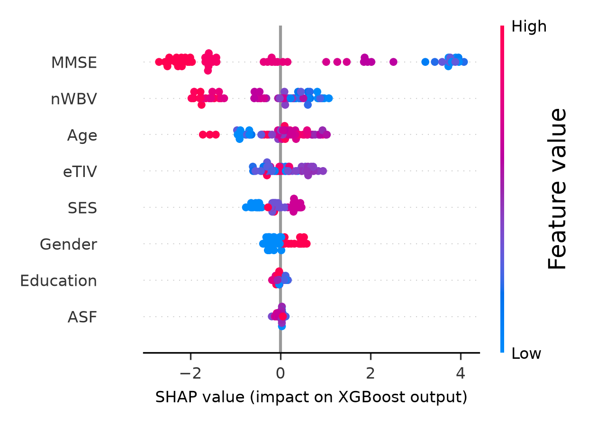
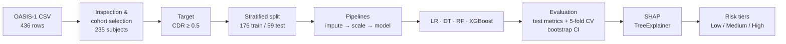
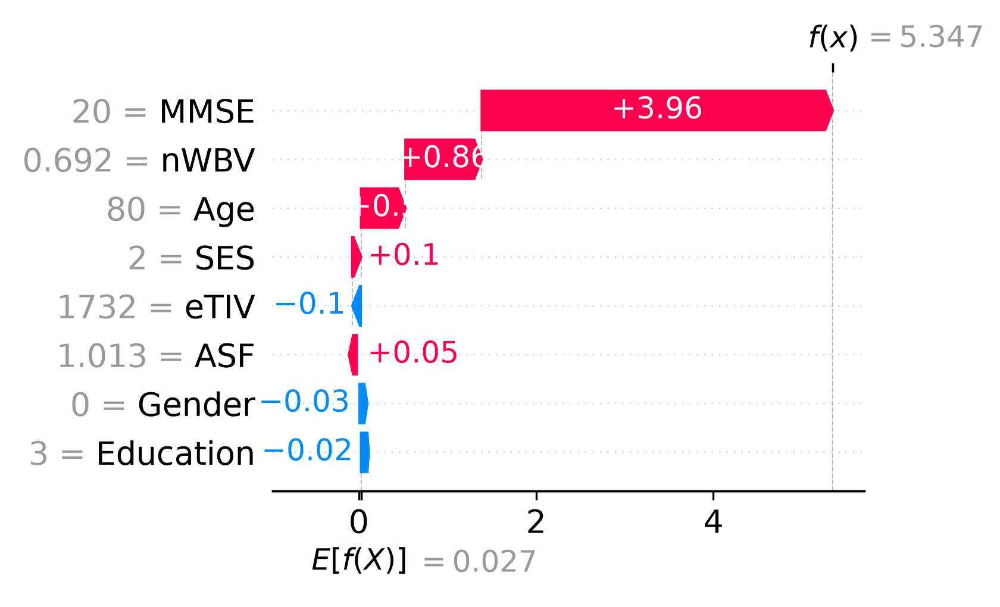
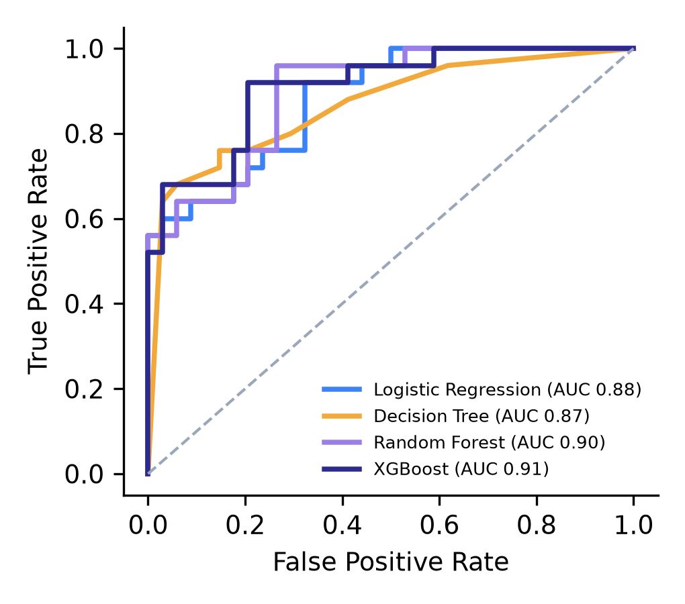
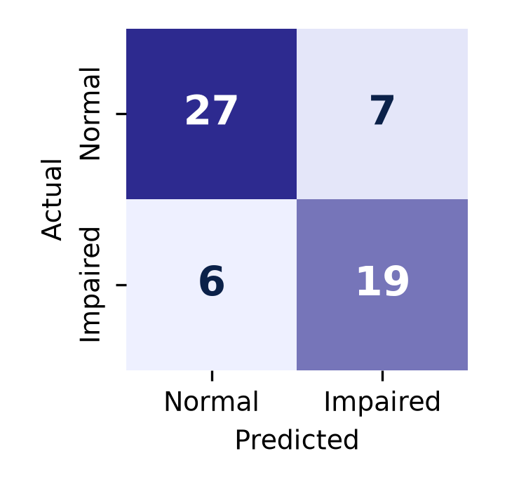
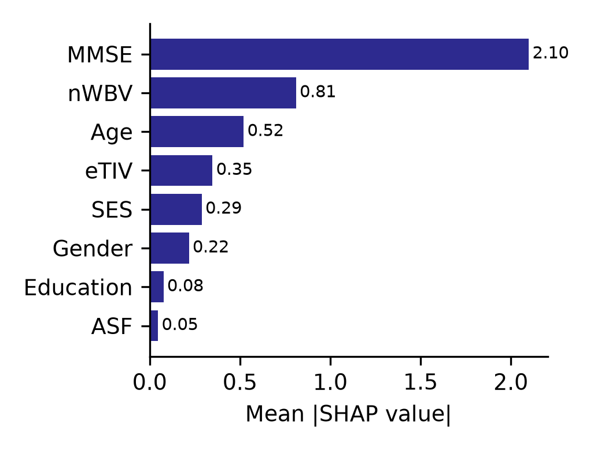
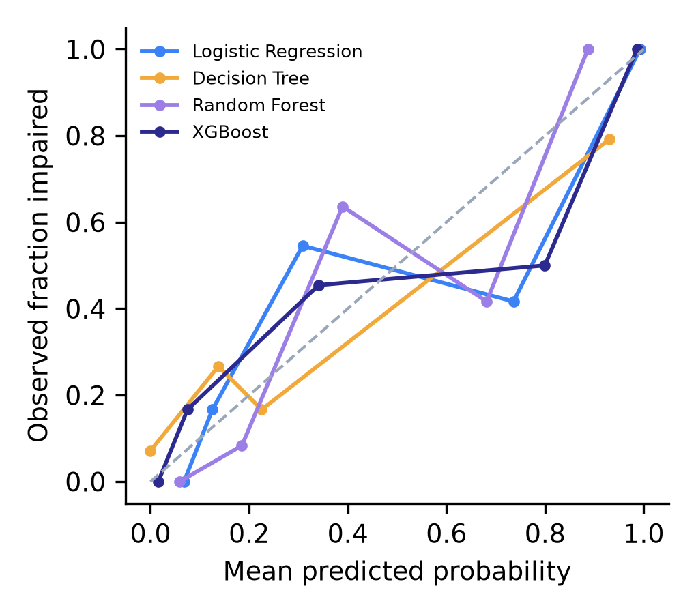

# Explainable Hybrid ML Framework for Alzheimer's Disease Risk Prediction

**An Explainable Hybrid Machine Learning Framework for Alzheimer's Disease Risk Prediction and Patient-Level Risk Stratification Using Multimodal Clinical Features**

Healthcare Analytics Mini Project · **Sharwil Bhende** (PRN 23070521137) · Department of Computer Engineering, Symbiosis Institute of Technology, Nagpur

    

---

> **Key results:** XGBoost reaches **ROC-AUC 0.91** on the held-out test set (5-fold CV **0.91 ± 0.03**).
> SHAP shows **MMSE** and **normalized whole-brain volume (nWBV)** drive most predictions, and the
> High-risk tier is **75 %** truly impaired vs **10 %** in the Low tier.

<p align="center">
  
</p>

## Overview

Alzheimer's disease (AD) is a progressive neurodegenerative disorder. This project estimates, for each
person, the **probability of current Alzheimer's-related cognitive impairment** from routinely available
measurements, explains every prediction with **SHAP**, and groups patients into **Low / Medium / High**
risk tiers.

* **Data:** OASIS-1 cross-sectional dataset — 416 subjects; 235 with a Clinical Dementia Rating (CDR).
* **Target:** `0` = cognitively normal (CDR = 0, n = 135), `1` = impaired (CDR ≥ 0.5, n = 100).
* **Inputs (8, multimodal):** demographic (Age, Gender, Education, SES), cognitive (MMSE), MRI-derived (eTIV, nWBV, ASF).
  CDR is **excluded** from the inputs because it defines the label.
* **Models:** Logistic Regression, Decision Tree, Random Forest, XGBoost (+ SVM and k-NN benchmarks).
* **Explainability:** exact TreeSHAP on XGBoost (global and per-patient).

> Research prototype for coursework — **not** a clinically validated diagnostic tool. It classifies
> *current* status from a single visit; it does not forecast future onset.

## Pipeline



## Results (held-out test set, n = 59; seed 42)

| Model | Accuracy | Precision | Recall | Specificity | F1 | ROC-AUC (95% CI) | 5-fold CV AUC |
|---|---|---|---|---|---|---|---|
| Logistic Regression | 0.763 | 0.720 | 0.720 | 0.794 | 0.720 | 0.881 (0.78–0.95) | 0.901 ± 0.036 |
| Decision Tree | **0.814** | **0.792** | **0.760** | **0.853** | **0.776** | 0.867 (0.76–0.95) | 0.854 ± 0.038 |
| Random Forest | 0.763 | 0.720 | 0.720 | 0.794 | 0.720 | 0.898 (0.81–0.96) | 0.908 ± 0.023 |
| **XGBoost (selected)** | 0.780 | 0.731 | **0.760** | 0.794 | 0.745 | **0.908 (0.82–0.97)** | **0.914 ± 0.027** |
| SVM (RBF) — benchmark | 0.780 | 0.731 | 0.760 | 0.794 | 0.745 | 0.876 (0.78–0.95) | 0.884 ± 0.035 |
| k-NN — benchmark | 0.763 | 0.739 | 0.680 | 0.824 | 0.708 | 0.838 (0.72–0.93) | 0.849 ± 0.031 |

XGBoost is selected for the highest and most stable discrimination (CV ROC-AUC). The Decision Tree
leads on threshold-based metrics at 0.5, but that edge is specific to one threshold on a small test set.

**SHAP (mean |SHAP|, XGBoost):** MMSE 2.10 · nWBV 0.81 · Age 0.52 · eTIV 0.35 · SES 0.29 · Gender 0.22 · Education 0.08 · ASF 0.05.
Low MMSE and low normalized whole-brain volume push predictions toward impairment.

**Risk tiers (XGBoost, test set):**

| Tier | Probability | Patients | Actually impaired |
|---|---|---|---|
| Low | < 0.30 | 30 | 3 (10%) |
| Medium | 0.30 – 0.60 | 5 | 4 (80%) |
| High | > 0.60 | 24 | 18 (75%) |

**Ablation (5-fold CV ROC-AUC):**

| Feature set | Logistic Regression | XGBoost |
|---|---|---|
| All features | 0.901 ± 0.036 | 0.914 ± 0.027 |
| MMSE + MRI | 0.909 ± 0.036 | 0.905 ± 0.030 |
| MMSE only | 0.887 ± 0.039 | 0.883 ± 0.035 |
| Without MMSE (demographic + MRI) | 0.789 ± 0.055 | 0.706 ± 0.088 |
| MRI only | 0.787 ± 0.032 | 0.699 ± 0.103 |
| Demographic only | 0.711 ± 0.098 | 0.696 ± 0.067 |

### Explaining a single patient

Each prediction comes with its own SHAP breakdown. Below, red bars push this patient's risk up and blue
bars push it down, starting from the model's average output:

<p align="center">
  
</p>

### Model performance

| ROC curves | Confusion matrix (XGBoost) |
|---|---|
|  |  |

| Global feature importance (mean \|SHAP\|) | Calibration |
|---|---|
|  |  |

## Repository structure

```
alzheimers-risk-xai/
├── data/
│   ├── oasis_cross-sectional.csv # OASIS-1 summary table (436 rows)
│   └── README.md                 # dataset description, source, citation
├── notebooks/
│   └── alzheimers_risk_analysis.ipynb   # step-by-step analysis with outputs
├── src/
│   ├── config.py                 # paths, seed, features, risk thresholds
│   ├── data.py                   # loading, cohort selection, target, split
│   ├── eda.py                    # summary tables and EDA figures
│   ├── models.py                 # model pipelines and hyperparameters
│   ├── evaluate.py               # metrics, CV, bootstrap CI, ROC/calibration plots
│   ├── explain.py                # SHAP values and plots
│   ├── risk.py                   # risk-tier assignment
│   ├── main.py                   # end-to-end pipeline
│   └── predict.py                # score a single patient from the command line
├── results/
│   ├── metrics.json              # every number reported in the paper
│   ├── model_comparison.csv · ablation.csv · risk_tiers.csv · feature_summary_by_class.csv
│   └── figures/                  # all plots (300 dpi)
├── models/xgboost_pipeline.joblib   # trained model (created by src.main)
├── tests/test_pipeline.py        # cohort, leakage and output sanity tests
├── requirements.txt
└── LICENSE
```

## How to run

```bash
git clone https://github.com/sharwil22/alzheimers-risk-xai.git
cd alzheimers-risk-xai
python -m venv .venv && source .venv/bin/activate      # Windows: .venv\Scripts\activate
pip install -r requirements.txt

# the OASIS-1 table is included at data/oasis_cross-sectional.csv  (see data/README.md)

python -m src.main            # trains, evaluates, explains; writes results/ and models/
pytest -q                     # 5 sanity tests
jupyter notebook notebooks/alzheimers_risk_analysis.ipynb
```

Score one patient with the trained model:

```bash
python -m src.predict --age 80 --gender F --educ 3 --ses 2 --mmse 20 --etiv 1732 --nwbv 0.692 --asf 1.013
# Probability of impairment : 0.995
# Risk tier                 : High
# Feature contributions (SHAP): MMSE +3.96, nWBV +0.86, Age +0.50, ...
```

## Methodology details

* **Cohort:** first session per subject (`_MR1`); 20 reliability re-scans and 181 subjects without CDR removed → 235 subjects, no duplicates.
* **Pre-processing:** median imputation (SES has 19 missing values), binary gender encoding, standardisation for LR / SVM / k-NN. All steps are inside scikit-learn `Pipeline`s, so they are fitted on training folds only.
* **Split:** stratified 75 / 25 (176 / 59), `random_state = 42`.
* **Class imbalance (57 : 43):** `class_weight="balanced"`; XGBoost `scale_pos_weight = n_neg / n_pos`.
* **Evaluation:** accuracy, precision, recall (sensitivity), specificity, F1, ROC-AUC with 2,000-sample bootstrap 95% CI, Brier score, stratified 5-fold CV ROC-AUC, calibration curves.
* **Explainability:** `shap.TreeExplainer` on the XGBoost model (log-odds scale).
* **Risk tiers:** provisional probability cut-offs 0.30 and 0.60.

| Model | Key hyperparameters |
|---|---|
| Logistic Regression | L2, C = 1.0, lbfgs, max_iter = 1000, balanced weights |
| Decision Tree | gini, max_depth = 4, min_samples_leaf = 5, balanced weights |
| Random Forest | 300 trees, max_features = sqrt, min_samples_leaf = 2, balanced weights |
| XGBoost | 200 trees, max_depth = 3, learning_rate = 0.05, subsample = 0.9, colsample_bytree = 0.9, scale_pos_weight = 1.35 |
| SVM (RBF) | C = 1.0, gamma = scale, balanced weights |
| k-NN | k = 7, distance weighting |

**Environment used for the reported results:** Python 3.12.8, scikit-learn 1.9.1, XGBoost 3.4.1, SHAP 0.54.1, pandas 3.1.0, NumPy 2.5.4, macOS arm64 (CPU only). XGBoost results can differ in the third decimal on other platforms. Training all models takes about one second.

## Limitations

* Small, single-site cross-sectional cohort (235 labelled subjects); no external validation.
* MMSE dominates the signal; MRI + demographics alone reach CV AUC ≈ 0.79.
* Risk thresholds are provisional and probabilities are not formally calibrated.
* Predicts current impairment, not future conversion to AD.

## References

* D. S. Marcus *et al.*, "Open Access Series of Imaging Studies (OASIS): Cross-sectional MRI data in young, middle aged, nondemented, and demented older adults," *J. Cogn. Neurosci.*, 19(9), 2007.
* S. M. Lundberg and S.-I. Lee, "A unified approach to interpreting model predictions," *NeurIPS*, 2017.
* T. Chen and C. Guestrin, "XGBoost: A scalable tree boosting system," *ACM SIGKDD*, 2016.
* F. Pedregosa *et al.*, "Scikit-learn: Machine learning in Python," *JMLR*, 12, 2011.

Data were provided by OASIS-1 (PIs: D. Marcus, R. Buckner, J. Csernansky, J. Morris; P50 AG05681, P01 AG03991, P01 AG026276, R01 AG021910, P20 MH071616, U24 RR021382).
